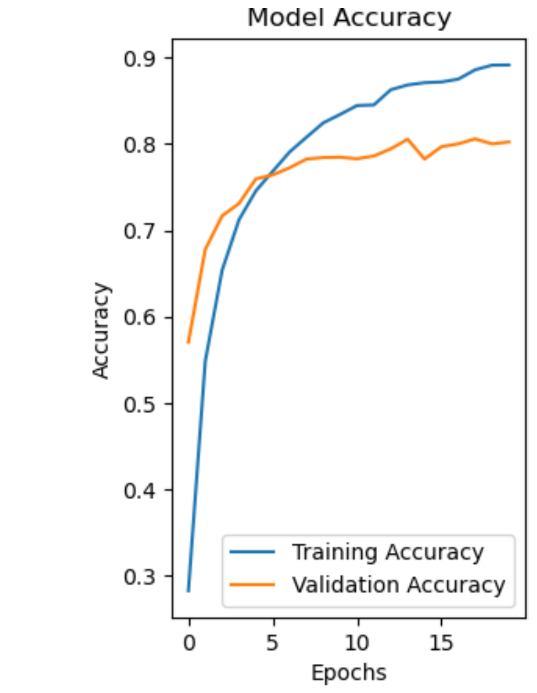
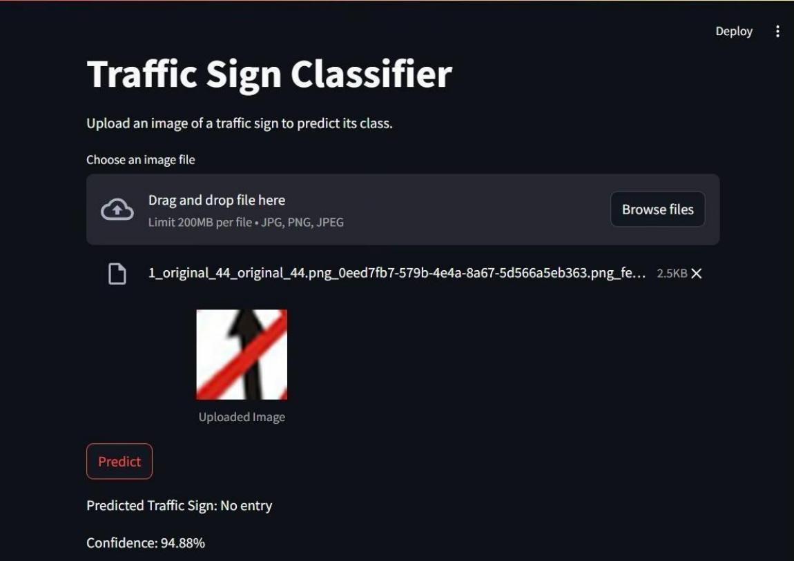

# Indian Traffic Sign Recognition

A convolutional neural network (CNN) that classifies images of **Indian traffic signs into 58 classes**,
such as speed limits, no entry, turns, junctions, level crossings and parking. It comes with a **Streamlit app**
where you upload a sign image and get the predicted sign with a confidence score.

**Project year:** 2024 · **Tech stack:** Python · TensorFlow/Keras · scikit-learn · pandas · Streamlit

Group project, B.Tech Computer Science & Engineering (AI & Data Science), 7th semester, Panipat Institute of
Engineering and Technology. Team: Chanchal Sharma, Utkarsh Sharma, Anshul and Diksha.
Supervisor: Ms. Aarti Chahal.

## Results

| Metric | Value |
| --- | --- |
| Validation accuracy (20 epochs) | **80.2%** |
| Training accuracy (20 epochs) | 89.7% |
| Classes | 58 |
| Validation images | 2,781 |

Validation accuracy levels off at around 80% after about 10 epochs while training accuracy keeps rising,
which shows the model starts to overfit. See "Possible improvements" below.



## The app



## Data

[Indian Traffic Sign Dataset](https://www.kaggle.com/datasets/neelpratiksha/indian-traffic-sign-dataset) from Kaggle:
about 14,000 images, one folder per sign class, plus `traffic_sign.csv` that maps each `ClassId` to the sign's name.
The images are not included in this repository because of their size. Download the dataset and arrange it like this:

```
data/
├── traffic_sign.csv
└── Images/
    ├── 0/
    ├── 1/
    └── ...
```

## How it works

1. **Load and inspect** the images and class names, and check how many images each class has.
2. **Preprocess:** resize every image to 64x64 pixels and scale pixel values to 0–1. 80% of the images are used
   for training and 20% for validation.
3. **CNN model:** two convolution + max-pooling blocks learn visual features such as edges, shapes and symbols;
   a dense layer with dropout (to reduce overfitting) then classifies the sign into one of the 58 classes.
4. **Train** for 20 epochs with the Adam optimiser and categorical cross-entropy loss.
5. **Evaluate** with a per-class classification report, the most confused pairs of signs, and example predictions.
6. **Serve** the trained model in a Streamlit web app (`app.py`).

## How to run

```bash
pip install -r requirements.txt
jupyter notebook traffic_sign_recognition.ipynb   # trains the model and saves it to models/
streamlit run app.py                               # opens the Traffic Sign Classifier in the browser
```

## Possible improvements

- Data augmentation (small rotations, shifts and zoom) and early stopping to reduce overfitting
- Batch normalisation and a deeper network
- Transfer learning with a pre-trained model such as MobileNetV2
- Detecting signs in full road images (e.g. with YOLO) before classifying them
